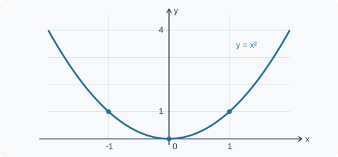

# 第一节 函数与极限

> 自编功能验收样例，用于测试提炼资料的交付形态，不代表任何用户提供的教材。
>
> 学习预算：约 60 分钟，包含阅读、理解与自检，属于估计。假设：已接触实数、区间和基本代数运算。

## 学习安排

函数与定义域 15 分钟，函数图像 10 分钟，极限与约分 20 分钟，最后用 15 分钟自检和订正。目标是能判断定义域，并说明函数值与极限的区别。

## 一、函数与定义域

函数给每一个允许的输入分配唯一输出。记为 $y=f(x)$：$x$ 是输入，$f(x)$ 是输出，定义域是允许输入的集合。

先检查表达式是否有意义，再做代数运算。两个常见限制是：分母不能为零，实数范围内偶次根号内的量不能为负。

### 例1 求下列函数的定义域

$$
f(x)=\frac{\sqrt{x+1}}{x-2}
$$

原题条件给出两个限制：

$$
\begin{cases}
x+1\geq 0,\\
x-2\neq 0.
\end{cases}
$$

同时满足它们，得到定义域 $[-1,2)\cup(2,+\infty)$。其中 $x=-1$ 可以取到；$x=2$ 必须排除。

**易错点：** 只看根号而忘记分母，会把不允许的 $x=2$ 放进定义域。

## 二、函数图像

图像把每个输入与输出配成一个点 $(x,f(x))$。对 $f(x)=x^2$，输入 $1$ 和 $-1$ 都得到输出 $1$，这不违反“每个输入只有一个输出”。

图1是补充示意。横轴表示输入 $x$，纵轴表示输出 $y$；不能把横轴位置和纵轴高度混为一谈。

| 输入 $x$ | $-2$ | $-1$ | $0$ | $1$ | $2$ |
| --- | --- | --- | --- | --- | --- |
| 输出 $x^2$ | $4$ | $1$ | $0$ | $1$ | $4$ |

## 三、极限关注趋近过程

“$x$ 趋近于 $a$”关心的是 $x$ 在 $a$ 附近变化时的行为，不要求它取到 $a$。

$$
\lim_{x\to a}f(x)=L
$$

表示在允许的趋近过程中，函数值趋近于 $L$。函数在 $a$ 点有无定义，与极限是否存在，需要分开判断。

### 例2 求下列极限

$$
\lim_{x\to 1}\frac{x^2-1}{x-1}
$$

**思路：** 因式分解后约去公共因子。极限过程中讨论的是 $x\neq 1$ 的附近点，因此可以约去 $x-1$。

$$
\frac{x^2-1}{x-1}
=\frac{(x-1)(x+1)}{x-1}
=x+1\quad(x\neq 1).
$$

所以结果为：

\[
\lim_{x\to 1}(x+1)=2.
\]

**易错点：** 原函数在 $x=1$ 没有定义，不妨碍该极限存在。约分得到的等式带有 $x\neq 1$ 的条件。

## 自检

1. 写出 $g(x)=\dfrac{1}{\sqrt{x-3}}$ 的定义域，并解释为什么不能包含 $3$。
2. 求 $\displaystyle\lim_{x\to 2}\dfrac{x^2-4}{x-2}$，说明哪一步需要用到 $x\neq 2$。

先独立完成，再查看提示。不会做时，回到“表达式有意义的条件”和“极限讨论附近点”这两处。

## 答案与提示

1. 定义域为 $(3,+\infty)$。根号要求 $x\geq 3$，分母非零进一步排除 $3$。
2. 因式分解为 $(x-2)(x+2)$，在 $x\neq 2$ 时约分，极限等于 $4$。
